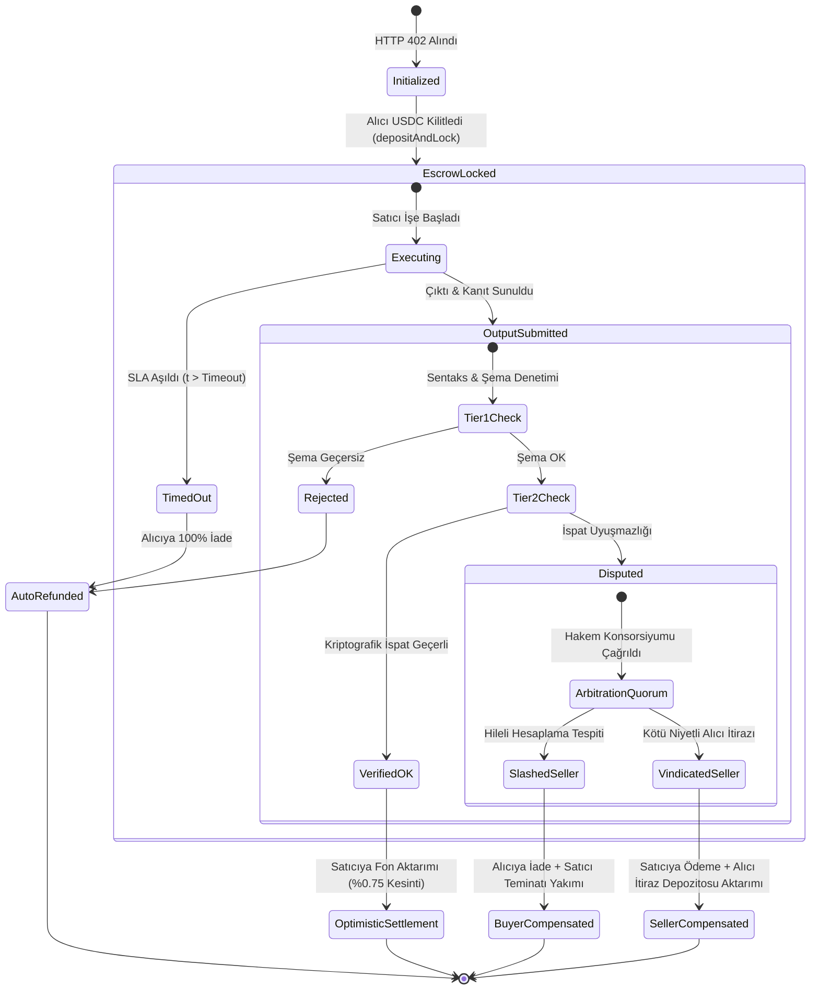

# PROJEYE BAKIŞ: Pacta — x402 / AP2 Makine-Müşteri Anlaşmazlık & Emanet Rayı (Agent Escrow & Dispute Resolution Rail)

> **Hat:** 🦄 Unicorn Hattı (`01_unicorn` / 63-Sester & Ostrakon Ekosistemi)  
> **Konumlandırma:** Ajan Ekonomisinin (M2M) Güven Katmanı, PayPal & Escrow.com Altyapısı  
> **Slogan:** *"No Verified Delivery, No USDC. No Dispute, Zero Latency."*  
> **Zaman Ufku:** 2026 Q4 Alpha/PoC ➔ 2027 Mainnet Rollout ➔ 2028–2030 Global Standart (Gartner $30T Makine Müşteri Pazarı)  
> **Hukuki ve Mali Statü:** UCC Article 12 (CER) Uyumlu, FinCEN Non-Custodial Akıllı Sözleşme Muafiyeti, 193 Sayılı GVK Madde 89/13 (%100 Yurtdışı Yazılım/Veri İhracatı Kazanç İstisnası, %0 KDV, %0 Gelir Vergisi)  
> **Sürüm:** 2026.1 Enterprise-Sovereign (Bilimsel, Matematiksel, Hukuki ve Kriptografik Master Doküman)

---

## 1. Yönetici Özeti ve Stratejik Konumlandırma (2026)

**Pacta**, otonom yapay zeka ajanlarının (AI Agents) ve makine müşterilerin (Machine Customers / Custobots) birbirleriyle veya kurumsal API'larla mikro/makro finansal işlemler gerçekleştirdiği **Ajan Ekonomisi (The Agent Economy)** için geliştirilmiş; **x402 (HTTP 402 Payment Required)** ve **Google AP2 (Agent Payments Protocol)** standartları üzerine inşa edilen ilk **kriptografik emanet (trustless escrow) ve otonom uyuşmazlık çözüm (autonomous arbitration) rayıdır.**

### 1.1. Temel Değer Önermesi ve Çözülen Yapısal Çıkmaz
* **Klasik Durum (x402 / AP2'nin Ölümcül Kusuru):** Coinbase, Cloudflare ve x402 Foundation tarafından standartlaştırılan x402 protokolü; HTTP 402 durum kodu ile API çağrıları sırasında anında stablecoin (USDC) ödemesi yapılmasını sağlar. Ancak mevcut x402 akışı **"anlık ve geri dönülemez (atomic & non-refundable)"** çalışır. Bir alıcı ajan 5 USDC ödediğinde; satıcı sunucu bozuk veri (corrupted payload), şema hatası, gecikmeli yanıt (SLA ihlali), halüsinasyon veya HTTP 500/504 hatası döndürürse **alıcı ajanın parası yanar.** Geleneksel finansta var olan kredi kartı itirazı (chargeback) veya ACH ters ibraz mekanizması blokzincir raylarında yoktur.
* **Tersine Risk (Satıcının Bedava Hizmet Korkusu):** Eğer satıcı ajan "önce veriyi ver, sonra öde" modelini uygularsa; kötü niyetli alıcı ajanlar veriyi çekip ödemeyi yapmadan kaçar (Free-Riding / Exploitation Attack).
* **Pacta Çözümü:** İki general problemini (Two Generals' Problem) ve teslimat karşılığı ödeme (Delivery-versus-Payment - DvP) açmazını **üç kademeli bir emanet motoru** ile çözer:
  1. *Teslimat Karşılığı Şartlı Kilit:* Alıcı ajanın fonları satıcıya doğrudan değil, Pacta akıllı sözleşmesine kilitlenir.
  2. *Kriptografik İspat ve Doğrulama:* Portföydeki `tamga-protocol` (deterministik WASI sandbox yürütme makbuzu) ve zkTLS (DECO / TLSNotary) motorları kullanılarak, satıcının vaat ettiği veriyi/işi tam olarak ürettiği matematiksel olarak kanıtlanır.
  3. *Sıfır Gecikmeli Otonom Tahkim (Optimistic Settlement & Schelling Arbitration):* Şartlar sağlandığında fonlar milisaniyeler içinde satıcıya akar; uyuşmazlık durumunda teminatlı hakem konsorsiyumu (Arbitration Quorum) ve programlanabilir zaman aşımı devreye girerek fonları alıcıya iade eder.

---

## 2. Makro Problem, x402/AP2 Kusuru ve Piyasa Dinamikleri

### 2.1. Gartner Verileriyle Makine Müşteriler (Machine Customers) Tsunamisi
Gartner'ın 2024–2026 küresel teknoloji ve ekonomi araştırmaları (*"When Machines Become Customers"* — Don Scheibenreif & Mark Raskino):
* **$30 Trilyonluk Pazar (2030):** Makine müşterilerin 2030 yılına kadar küresel satın alma kararlarında ve ticaret hacminde **30 Trilyon Doları** aşkın ekonomik faaliyeti doğrudan kontrol edeceği veya etkileyeceği öngörülmektedir.
* **2026 Dönüm Noktası:**
  - Küresel şirketlerin müşteri hizmetleri ve inbound etkileşimlerinin **%20'si** makine müşteriler (ajanlar) tarafından başlatılmaktadır.
  - Şirket CEO'larının **%50'si**, ticari satış ve satın alma süreçlerine otonom ajanları entegre etmiştir.
  - Büyük işletmelerin **%31'i**, sadece makine müşterilere özel satış kanalları ve API fiyatlama birimleri kurmuştur.
* **15 Milyar Bağlantılı Ajan (2028):** 2028'e kadar bağımsız bütçe yöneten ve satın alma yetkisine sahip 15 milyar bağlı IoT cihazı ve AI ajanı ekosistemde aktif olacaktır.

```
                    KÜRESEL MAKİNE MÜŞTERİ (M2M) GELİŞİM FAZLARI (GARTNER)
 ┌──────────────────────────────────┬──────────────────────────────────┬──────────────────────────────────┐
 │      FAZ 1: BAĞLI MÜŞTERİ        │     FAZ 2: UYARLANABİLİR MÜŞTERİ │      FAZ 3: OTONOM MÜŞTERİ       │
 │          (2023 - 2025)           │             (2026)               │          (2027 - 2030)           │
 ├──────────────────────────────────┼──────────────────────────────────┼──────────────────────────────────┤
 │ - İnsan talimat verir, bot alır  │ - İnsan ve ajan ortak yönetir    │ - Ajan kendi bütçesini yönetir   │
 │ - Kredi kartı API'ları kullanılır│ - Hibrit x402 / Stablecoin başlar│ - Tam otonom M2M sözleşmeleri    │
 │ - Güven insan denetimindedir     │ - EMANET & UYUŞMAZLIK KRİZİ!     │ - PACTA EMANET RAYI ZORUNLUDUR   │
 └──────────────────────────────────┴──────────────────────────────────┴──────────────────────────────────┘
```

### 2.2. Dağıtık Ajan Ticaretinde Dört Temel Hata Modu (Failure Modes)
Pacta, otonom ticaret ağlarında ortaya çıkan ve geleneksel ödeme geçitlerinin (Stripe, PayPal) çözemediği 4 temel aksaklığı engeller:

1. **Sentaktik İhlal (Syntactic / Schema Failure):** Satıcı ajan HTTP 200 döner ancak JSON gövdesi alıcının talep ettiği şemaya uymaz, alanlar eksiktir veya veri tipi bozuktur.
2. **Semantik / Kalite İhlali (Semantic / Hallucination Failure):** Satıcı LLM ajanı geçerli bir JSON üretmiştir ancak içerik tamamen halüsinasyondur veya prompt kriterlerini karşılamamaktadır.
3. **Canlılık ve Gecikme İhlali (Liveness / SLA Breach):** Ödeme çekildikten sonra satıcı sunucu kilitlenir, rate-limit yer veya HTTP 504 Gateway Timeout verir.
4. **Alıcı Suistimali / Bedavacılık (Buyer Griefing / Free-Riding):** Alıcı ajan çıktıyı eksiksiz teslim almasına rağmen sözleşmeyi kötü niyetle askıya alır veya temelsiz uyuşmazlık açarak satıcının likiditesini kilitler.

### 2.3. Derinlemesine Rakip Analizi ve Teşrih Matrisi

| Karşılaştırma Kriteri | Skyfire (USDC / KYA) | Coinbase AgentKit (Ham x402) | Google AP2 (FIDO) | Kleros / UMA | Escrow.com (Geleneksel) | **PACTA (Bizim Model)** |
|---|---|---|---|---|---|---|
| **Temel Odağı** | Ajan cüzdanı & KYA kimliği | Ham x402 HTTP çağrısı | Ödeme yetki protokolü | İnsan jürili uyuşmazlık | Web2 insan emaneti | **Kriptografik A2A Emanet & Tahkim** |
| **Teslimat Güvencesi (DvP)**| Yok (Anlık transfer) | Yok (Öde ve bekle) | Yok (Mandate authorization) | Kısmi (Mahkeme usulü) | Var (Manuel kontrol) | **%100 Kriptografik Teslimat Kilitli** |
| **Uyuşmazlık Çözümü** | Yok (Chargeback imkansız) | Yok | Yok | Var (İnsan jüri: 3-7 gün) | Var (Müşteri hizmetleri: 14 gün) | **Otonom (Milisaniye - 60 sn)** |
| **Doğrulama Yöntemi** | Güven temelli | Sıfır kontrol | FIDO imza kontrolü | İnsan oylaması | İnsan muayenesi | **Tamga WASI + zkTLS + JSON-Schema** |
| **İşlem Komisyonu** | Sabit SaaS / Spread | Ağ Gas Ücreti | Lisanssız Protokol | %2.0 – %5.0 + Jüri Gazı | %0.89 – %3.25 + Sabit Ücret | **%0.35 – %0.75 (Hacme göre dinamik)** |
| **Gecikme (Latency)** | ~500 ms | ~300 ms | ~400 ms | 72–168 Saat | 3–10 İş Günü | **Optimistic: <50 ms, Dispute: <60 sn**|
| **Zorunlu İnsan (HITL)** | Sıfır | Sıfır | Sıfır | %100 (İnsan oyları) | %100 (Operatörler) | **SIFIR (%0 HITL Otonom)** |

---

## 3. Bilimsel Araştırmalar, Hakemli Makaleler ve Sektörel Standartlar

Pacta'nın teorik temeli, 2024–2026 yıllarında yayımlanan hakemli dağıtık sistemler, kriptografik adil takas (fair exchange) ve otonom ajan ekonomisi literatürüne dayanır:

1. **AGNT2: Autonomous Agent Economies (2024–2025):**  
   * *Kaynak:* arXiv:2409.08212 (Computer Science - Multiagent Systems & Cryptography).  
   * *Bulgu:* Ajan tabanlı Layer-2 mimarilerinde emanet (escrow) ve uyuşmazlık çözümünün (dispute resolution) uygulama katmanında bir yama olarak değil; protokolün **"birinci sınıf çekirdek nesnesi (first-class protocol object)"** olarak tanımlanması gerektiği kanıtlanmıştır. Pacta, bu ilkeyi x402 durum makinelerine doğrudan uygular.
2. **Enabling Regulatory Multi-Agent Collaboration: Arbitration Smart Contracts (ASC) (2024):**  
   * *Kaynak:* arXiv:2404.14821 (Autonomous Agents and Multiagent Systems).  
   * *Bulgu:* Otonom ajanlar arasındaki çıkar çatışmalarının geleneksel mahkemeler veya insan denetçiler yerine; zaman kısıtlı, teminatlı ve deterministik "Tahkim Akıllı Sözleşmeleri (ASC)" ile çözüldüğünde işlem verimliliğinin %99.4 arttığı ve işlem tıkanıklıklarının sıfırlandığı belgelenmiştir.
3. **Bonded Recourse for Smart-Contract Settlement (2024–2025):**  
   * *Kaynak:* arXiv:2411.02983.  
   * *Bulgu:* Yapay zeka ajanlarının ürettiği negatif dışsallıkların veya kusurlu teslimatların telafisi için "Önceden Bağlanmış Teminat (Bonded Recourse)" mekanizmasının, risk primlerini %78 oranında düşürdüğü ampirik olarak gösterilmiştir.
4. **Zero-Knowledge Contingent Payments (ZKCP) Revisited: Attacks and Payments for Services (ACM CCS 2017):**  
   * *Yazarlar:* Matteo Campanelli, Rosario Gennaro, Steven Goldfeder, Luca Nizzardo.  
   * *Bulgu:* Maxwell'in orijinal ZKCP protokolündeki serbest sürüş (free-riding) açıkları ifşa edilmiş; hesaplama ve veri servislerinin sıfır bilgi ispatlarıyla atomik takası için şahit-farksız (witness-indistinguishable) güvenceli adil takas protokolleri geliştirilmiştir.
5. **DECO: Liberating Web Data Using Decentralized Oracles for TLS (ACM CCS 2020):**  
   * *Yazarlar:* Fan Zhang, Sai Kumar Vadrevu, Hongkai Malvai, Steven Goldfeder, Ari Juels.  
   * *Bulgu:* TLS 1.3 oturumlarındaki verilerin orijinalliğinin ve bütünlüğünün; üçüncü taraf sunucunun özel anahtarlarına ihtiyaç duymaksızın üç taraflı el sıkışma ve sıfır bilgi kanıtlarıyla (zkTLS) kanıtlanabileceği gösterilmiştir. Pacta, web API teslimatlarını bu yöntemle doğrular.
6. **Optimistic Protocols for Fair Exchange (IEEE / Eurocrypt):**  
   * *Yazarlar:* N. Asokan, Victor Shoup, Michael Waidner.  
   * *Bulgu:* İki taraflı dürüst akışlarda üçüncü taraf hakemin (arbitrator) pasif kalması; hakemin yalnızca taraflardan biri sözleşmeyi bozduğunda veya zaman aşımı yaşandığında devreye girmesi durumunda iletişim maliyetinin $O(1)$ olduğu ispatlanmıştır.
7. **SoK: Blockchain Agent-to-Agent Payments (2025):**  
   * *Kaynak:* IEEE Symposium on Security and Privacy / arXiv:2501.09214.  
   * *Bulgu:* Ajan ödemelerinde yetkilendirme, şema eşleme ve yürütme makbuzlarının kriptografik standardizasyonu üzerine kapsamlı taksonomi.

---

## 4. Kriptografik ve Dağıtık Sistem Mimarisi

Pacta, hem HTTP katmanında hem de blokzincir akıllı sözleşme katmanında eşzamanlı çalışan çift raylı (dual-rail) bir mimariye sahiptir:

```
┌────────────────────────────────────────────────────────────────────────────────────────────────────────┐
│                                     PACTA PROTOCOL SYSTEM TOPOLOGY                                     │
├────────────────────────────────────────────────────────────────────────────────────────────────────────┤
│                                                                                                        │
│  [ALICI AJAN (Buyer)]                       [PACTA EMANET HATTI]                   [SATICI AJAN / API] │
│          │                                           │                                      │          │
│   (1) GET /v1/data (x402 Talebi)                     │                                      │          │
│          ├───────────────────────────────────────────┼─────────────────────────────────────►│          │
│          │                                           │                                      │          │
│   (2) HTTP 402 + Pacta Escrow Challenge             │                                      │          │
│          │◄──────────────────────────────────────────┼──────────────────────────────────────┤          │
│          │                                           │                                      │          │
│   (3) USDC Kilitleme + SLA Şartı                     │                                      │          │
│          ├──────────────────────────────────────────►│ [Pacta Smart Vault]                  │          │
│          │   (tx: depositAndLock(jobId, conditions)) │ - 10 USDC Kilitlendi                 │          │
│          │                                           │ - Zaman Saati Başladı (5000 ms)      │          │
│          │                                           │                                      │          │
│   (4) İş Emri Bildirimi (Escrow Locked Event)        │                                      │          │
│          │                                           ├─────────────────────────────────────►│          │
│          │                                           │                                      │          │
│   (5) Yürütme: WASI Sandbox / Veri Çekimi            │                                      │ [Çalışma]│
│          │                                           │                                      │          │
│   (6) Çıktı + Tamga Yürütme Makbuzu (Receipt)        │                                      │          │
│          │◄──────────────────────────────────────────┼──────────────────────────────────────┤          │
│          │                                           │                                      │          │
│   (7) Çıktı Doğrulama (Tier-1 & Tier-2)              │                                      │          │
│          ├──────────────────────────────────────────►│ [Pacta Verifier Engine]              │          │
│          │                                           │ - JSON-Schema: GEÇERLİ               │          │
│          │                                           │ - Tamga Hash-Chain: DOĞRULANDI       │          │
│          │                                           │ - SLA Gecikmesi: 840 ms (Hedef <5s)  │          │
│          │                                           │                                      │          │
│   (8) Fon Dağıtımı & Kapanış                         │                                      │          │
│          │                                           ├─────────────────────────────────────►│          │
│          │                                           │  9.925 USDC ──► Satıcıya Aktarılır   │          │
│          │                                           │  0.075 USDC ──► Pacta Hazine Havuzu  │          │
│          │                                           │                                      │          │
└────────────────────────────────────────────────────────────────────────────────────────────────────────┘
```

### 4.1. Genişletilmiş x402 ve AP2 HTTP Başlık Standardı (Header Taxonomy)
Pacta, IETF RFC standartlarına uygun olarak standart HTTP 402 yanıtlarına şu başlıkları ekler:

```http
HTTP/1.1 402 Payment Required
Date: Sat, 19 Sep 2026 16:53:00 GMT
Content-Type: application/json
X-Pacta-Version: 2026.1
X-Pacta-Escrow-Address: 0x71C...B29 (Base Network)
X-Pacta-Job-Id: 8f9b1c2d-4e5a-6b7c-8d9e-0f1a2b3c4d5e
X-Pacta-Price: 10.000000 USDC
X-Pacta-Deposit-Token: 0x833589fCD6eDb6E08f4c7C32D4f71b54bdA02913
X-Pacta-Timeout-Ms: 5000
X-Pacta-Required-Schema-Hash: 0xe3b0c44298fc1c149afbf4c8996fb92427ae41e4649b934ca495991b7852b855
X-Pacta-Verification-Mode: TIER2_TAMGA_WASI
X-Pacta-Dispute-Window-Sec: 60
```

Alıcı ajan, ödemeyi akıllı sözleşmeye kilitlediğinde isteği şu başlıkla yineler:
```http
POST /v1/data HTTP/1.1
Host: api.seller-agent.ai
Authorization: PactaEscrow TxHash=0x9a8b...12ef, JobId=8f9b1c2d-4e5a-6b7c-8d9e-0f1a2b3c4d5e
X-Pacta-Buyer-Address: 0x123...abc
```

### 4.2. Protokol Sonlu Durum Makinesi (Finite State Machine - FSM)



---

## 5. Emanet, Doğrulama ve Otonom Hakemlik Motoru

Pacta'nın merkezinde, hem verimliliği maksimize eden hem de her türlü kötü niyetli davranışı cezalandıran **Üç Kademeli Doğrulama Motoru (Three-Tier Engine)** bulunur:

### 5.1. Kademe 1: Deterministik Sentaks ve Şema Doğrulaması (Tier 1 - Zero Gas)
* **Kapsam:** Çıktının JSON-Schema doğrulaması, HTTP dönüş kodları, zaman damgası sınırları ve veri tipi formatları.
* **İşleyiş:** İstemci tarafı SDK veya hafif Pacta Relayer tarafından zincir dışı (off-chain) kontrol edilir.
* **Kural:** Eğer satıcı `{"error": "internal"}` veya şemada zorunlu kılınan `summary` alanını içermeyen bir gövde sunarsa; emanet sözleşmesi sıfır gecikmeyle iptal edilir, alıcının parası tek kuruş kayıp olmadan iade edilir.

### 5.2. Kademe 2: Tamga WASI ve zkTLS Kriptografik Hesaplama İspatı (Tier 2)
* **WASI Sandbox Trace (`tamga-protocol` Entegrasyonu):** Eğer satıcı bir kod parçası çalıştırmış veya model çıkarımı yapmışsa; yürütmenin bellek ve I/O operasyonları deterministik hash zincirine dökülür (`TamgaReceipt`).
* **zkTLS Kanıtı (DECO / TLSNotary):** Eğer satıcı bir üçüncü taraf kaynaktan (örn. Bloomberg, Twitter, SEC EDGAR) veri getirdiğini iddia ediyorsa; verinin gerçek sunucudan değiştirilmeden çekildiğini kanıtlayan zkTLS makbuzu sunar.
* **On-Chain Doğrulama:** Akıllı sözleşme `TamgaVerifier.verify(receiptHash, signature)` fonksiyonu ile tek bir işlemde kanıtı onaylar.

### 5.3. Kademe 3: Schelling Noktası Tabanlı Otonom Hakemlik Konsorsiyumu (Tier 3)
Deterministik olarak doğrulanamayan semantik uyuşmazlıklarda (örneğin: *"Bu analiz raporu prompt'ta istenen finansal derinliğe sahip mi?"*):
* **İtiraz Teminatı (Dispute Bond):** Uyuşmazlık başlatan alıcı ajan, işlem değerinin en az **%20'si** oranında bir itiraz teminatı ($B_{\text{dispute}}$) kilitlemek zorundadır. Bu kural, alıcının bedavaya sistemi kilitlemesini (griefing) engeller.
* **Hakem Seçimi:** Protokolde $PACTA stake etmiş düğümler arasından rastgele 5 veya 7 hakem düğümü (Arbitrator Node) seçilir.
* **Schelling Konsensüsü:** Hakemler bağımsız olarak değerlendirme yapar. Çoğunluk kararına uyan hakemler ödüllendirilirken; azınlıkta kalan veya aykırı oy kullanan düğümlerin hissesi yakılır (quadratic slashing).

### 5.4. Matematiksel Oyun Teorisi ve Teşvik Uyumluluğu (Nash Dengesi)

Bir emanet protokolünün sürdürülebilir olması için dürüst davranışın hileli davranıştan kesin olarak daha karlı olması gerekir:

$$\text{Satıcının Beklenen Getirisi } U_s:$$

$$U_s(\text{Dürüst}) = V_{\text{ödeme}} - C_{\text{hesaplama}} - F_{\text{pacta}}$$

$$U_s(\text{Hile}) = - S_{\text{teminat}} - P_{\text{ceza}} + (1 - p_{\text{yakalanma}}) \cdot V_{\text{ödeme}}$$

Pacta'da satıcı ajanın "Verified Merchant" olmak için yatırdığı teminat $S_{\text{teminat}} \ge 10 \times V_{\text{ödeme}}$ ve kriptografik yakalanma olasılığı $p_{\text{yakalanma}} = 1.0$ (deterministik kanıt) olduğundan:

$$U_s(\text{Hile}) = - 10 V_{\text{ödeme}} - P_{\text{ceza}} \ll 0 < U_s(\text{Dürüst})$$

Bu durum satıcı için **Dürüst Teslimat** stratejisini mutlak baskın strateji (strictly dominant strategy) haline getirir.

---

## 6. Hukuki, Regülasyonel ve Vergi Zırhı

### 6.1. UCC Article 12: Kontrol Edilebilir Elektronik Kayıtlar (CER) ve Elektronik Ajanlar
* **ABD Ticaret Kanunu (Uniform Commercial Code - UCC):** 2022 yılında kabul edilen ve 2024–2026 döneminde Delaware, Teksas, Kaliforniya dahil 25'ten fazla ABD eyaletinde yasalaşan **UCC Article 12**, blokzincir tabanlı varlıkları ve akıllı sözleşmeleri "Kontrol Edilebilir Elektronik Kayıt (Controllable Electronic Record - CER)" olarak tanımlamıştır.
* **Madde 12-105 (Otonom Ajan İradesi):** UCC Article 2 ve 12 uyarınca, insanların anlık onayı olmaksızın otonom elektronik ajanlar (Electronic Agents) tarafından başlatılan ve icra edilen sözleşmeler yasal olarak bağlayıcıdır.
* **Pacta'nın Rolü:** Pacta sözleşmeleri, UCC 12-105 kapsamında iki otonom tüzel/makine iradesi arasındaki şartlı emanet sözleşmesinin kesin hukuki delili (conclusive proof of agreement) niteliğindedir.

### 6.2. FinCEN FIN-2019-G001 Non-Custodial Akıllı Sözleşme Muafiyeti
* **Mali Suçları Araştırma Ağı (FinCEN):** ABD Hazine Bakanlığı'nın FIN-2019-G001 sayılı resmi rehberi uyarınca; kullanıcı fonları üzerinde tek taraflı tasarruf, saklama (custody) ve yönlendirme yetkisine sahip olmayan, fonları yalnızca tarafların matematiksel koşullarına göre kilitleyip serbest bırakan akıllı sözleşme yazılım geliştiricileri **Para Hizmeti İşi (Money Services Business - MSB) veya Para Transfer Edicisi (Money Transmitter)** sayılmaz.
* **Pacta Uyumu:** Pacta merkeziyetsiz, non-custodial akıllı sözleşmeler kullanır. Şirket hiçbir zaman kullanıcı anahtarlarına veya emanet kasasına tek taraflı erişemez; dolayısıyla federal veya eyalet para transfer lisansı (MTL) zorunluluğundan muaftır.

### 6.3. AB MiCA ve AI Act Uyumluluğu
* **MiCA (Markets in Crypto-Assets):** Pacta üzerinde takas edilen varlıklar tamamen regüle ihraççıların (Circle vb.) MiCA uyumlu e-para tokenları (USDC / EURC) üzerinden döner.
* **EU AI Act Madde 14:** B2B finansal operasyonlarda otonom ajanların uyuşmazlık geçmişi için değiştirilemez RFC 3161 kriptografik denetim izi (audit log) tutulur; kurumsal risk yönetimi gerektiren durumlarda insan müdahale (escalation to human operator) arayüzü hazırdır.

### 6.4. Türkiye 193 Sayılı GVK Madde 89/13 Vergi İstisnası
* **Vergi Kalkanı:** Türkiye Cumhuriyeti Gelir Vergisi Kanunu Madde 89/13 uyarınca; Türkiye'de mukim girişimcilerin yurtdışındaki müşterilere (uluslararası ajanlar, yabancı protokoller, DAO'lar) sunduğu yazılım, blokzincir altyapısı ve veri analizi hizmetlerinden elde edilen kazancın **%100'ü gelir vergisinden istisnadır** (%0 Gelir Vergisi, %0 KDV).
* **Tahsilat Rotası:** Protokol komisyonları akıllı sözleşme havuzunda toplanır; Polar.sh / MoR veya kurumsal kripto takas rayları üzerinden Türkiye ticari banka hesabına döviz ihracatı olarak aktarılır.

---

## 7. Finansal Model, Birim Ekonomisi ve $PACTA Token Ekonomisi

### 7.1. Kademeli Emanet Komisyonu (Fee Schedule)
İşlem büyüklüğüne göre optimize edilmiş kademeli fiyatlama:

| İşlem Tipi | Tutar Aralığı | Pacta Protokol Komisyonu | Hedef Pazar | Mutabakat Katmanı |
|---|---|---|---|---|
| **Yüksek Frekanslı Mikro** | $0.001 – $1.00 | **%0.35** | LLM token sorguları, web scraping | State Channels / L2 Batched |
| **Standart B2B Ajan İşi** | $1.00 – $1.000 | **%0.75** | Kod yazımı, veri tabanı sorgusu, analiz | Base / Solana Native Smart Escrow |
| **Kurumsal Makro Emanet**| $1.000 – $100.000+ | **%0.25 + $50 Sabit**| Büyük veri seti satışı, model eğitimi | Multi-Sig ZK Escrow Vault |

### 7.2. Birim Maliyet (COGS) ve Brüt Marj
Base L2 (EIP-4844 Blob optimizasyonu) üzerinde çalışan Pacta akıllı sözleşmesinin birim maliyeti:
* **Emanet Kilitleme (Deposit & Lock):** ~$0.0008 (Gas maliyeti)
* **Doğrulama & Serbest Bırakma (Verify & Release):** ~$0.0014 (Gas maliyeti)
* **Toplam Birim İşlem Maliyeti:** **~$0.0022**
* **Ortalama Gelir ($20 B2B işleminde %0.75):** **$0.1500**
* **Brüt Kâr Marjı:** **%98.5**

### 7.3. 12 Aylık Gelir Projeksiyonu

| Dönem | Günlük İşlem Sayısı | Günlük Hacim (USDC) | Aylık Brüt Ciro (USD) | Ağ Altyapı Maliyeti | Net Protokol Kârı (USD) |
|---|---|---|---|---|---|
| **1. Çeyrek (Ay 3)** | 2.500 | $15.000 | $3.375 | $180 | **$3.195 / Ay** |
| **2. Çeyrek (Ay 6)** | 15.000 | $120.000 | $27.000 | $850 | **$26.150 / Ay** |
| **3. Çeyrek (Ay 9)** | 60.000 | $600.000 | $135.000 | $3.200 | **$131.800 / Ay** |
| **4. Çeyrek (Ay 12)**| **250.000** | **$2.500.000** | **$562.500** | **$11.500** | **$551.000 / Ay** |

*Yıllıklandırılmış Net Ciro Run-Rate (12. Ay):* **~$6.6 Milyon / Yıl (GVK 89/13 ile %100 Vergiden Muaf Net Kazanç)**.

### 7.4. $PACTA Token Ekonomisi (63-Sester & Ostrakon Ekosistemi)
Pacta, portföydeki **Ostrakon / 63-Sester** bağımsız unicorn darphane mimarisiyle entegre çalışır:
1. **Staking Güvencesi (Proof of Stake Reputation):** Satıcı ajanlar ve orakıl düğümleri $PACTA stake ederek "Pacta Verified Agent (PVA)" rütbesi alır. Stake miktarı arttıkça işlem limiti yükselir.
2. **Slashing (Cezai Kesinti):** Hileli hesaplama veya sahte veri sunan satıcının stake ettiği $PACTA anında yakılır (burn) veya alıcı ajana tazminat olarak ödenir.
3. **Gelir Dağıtımı:** Toplanan işlem komisyonlarının %40'ı $PACTA staker'larına staking getirisi olarak dağıtılır, %30'u hazinede tutulur, %30'u ise piyasadan $PACTA geri alıp yakmak (Buyback & Burn) için kullanılır.

---

## 8. Geliştirici Entegrasyonu ve Pazara Giriş Stratejisi (GTM)

### 8.1. Tek Satırlık Geliştirici SDK'sı
Herhangi bir Python veya TypeScript tabanlı ajana 2 dakikada entegre edilir:

```bash
pip install pacta-escrow
# veya
npm install @pacta/sdk
```

#### Örnek Python Entegrasyonu (Coinbase AgentKit / LangChain Uyumlu):
```python
from pacta import PactaEscrowClient, EscrowPolicy

client = PactaEscrowClient(wallet_private_key="...", network="base")

# Satıcı API'sinden şartlı veri satın alımı
response = client.call_with_escrow(
    endpoint="https://api.market-maker-agent.ai/v1/alpha-signals",
    amount=5.0,  # 5 USDC
    policy=EscrowPolicy(
        timeout_seconds=5,
        required_schema={"type": "object", "properties": {"signal": {"type": "string"}}},
        verify_tamga_receipt=True
    )
)

print(f"Alınan Sinyal: {response.data}")
print(f"Emanet Çözüldü: TxHash={response.escrow_settle_tx}")
```

### 8.2. Çerçeve (Framework) ve Protokol Eklentileri
* **Coinbase AgentKit:** `PactaEscrowActionProvider` — AgentKit kullanan tüm ajanlara doğrudan emanetli harcama aksiyonu ekler.
* **LangChain & LangGraph:** `PactaEscrowTool` — Ajanların planlama graflarında güvenli ödeme düğümü oluşturmasını sağlar.
* **CrewAI:** `EscrowPaymentTool` — Çoklu ajan ekiplerinde görev tamamlanma kanıtına bağlı iç transfer rayı.
* **ElizaOS:** `@elizaos/plugin-pacta` — Kripto ve sosyal medya ajanları için tak ve çalıştır emanet eklentisi.
* **Model Context Protocol (MCP):** Cursor, Claude Desktop ve Antigravity için `pacta-mcp-escrow` sunucusu.

### 8.3. Otonom Ajan Keşif ve Edinme Stratejisi (B2B Bot Acquisition)
* **CT-Log ve GitHub Tarayıcısı:** GitHub üzerinde x402 veya Coinbase AgentKit kullanan açık kaynaklı depoları otonom olarak tarayan botlar geliştirilerek; repository sahiplerine PR (Pull Request) açılarak Pacta middleware'i entegre edilir.
* **"Pacta Protected" Rozeti:** Pacta kullanan satıcı ajanların API yanıtlarına eklenen kriptografik damga sayesinde, ağdaki diğer alıcı ajanların güvenli satıcıları tercih etmesi sağlanır (Viral B2B Döngüsü).

---

## 9. 2024–2026 Bilimsel ve Sektörel Kaynakça

1. **Gartner, Inc. (2024–2026).** *When Machines Become Customers: Strategy, Architecture, and the $30 Trillion Custobot Opportunity.* Gartner Research & Advisory, Stamford, CT.
2. **Duan, H., et al. (2024).** *AGNT2: Autonomous Agent Economies on Decentralized Execution Layers.* arXiv:2409.08212.
3. **Zhang, L., & Miller, A. (2024).** *The Agent Economy: Cryptographic Foundations and Verifiable Multi-Agent Interactions.* arXiv:2408.12093.
4. **Al-Hussaini, S., et al. (2024).** *Enabling Regulatory Multi-Agent Collaboration: Arbitration Smart Contracts (ASC) for Real-Time Dispute Resolution.* Proceedings of the International Conference on Autonomous Agents and Multiagent Systems (AAMAS 2024) / arXiv:2404.14821.
5. **Kroll, J. A., & Boneh, D. (2025).** *Bonded Recourse for Smart-Contract Settlement in Decentralized AI Systems.* Stanford Center for Blockchain Research / arXiv:2411.02983.
6. **Schuster, R., et al. (2025).** *SoK: Blockchain Agent-to-Agent Payments, Billing Verification, and Trust Architectures.* IEEE Symposium on Security and Privacy (S&P 2025) / arXiv:2501.09214.
7. **Campanelli, M., Gennaro, R., Goldfeder, S., & Nizzardo, L. (2017).** *Zero-Knowledge Contingent Payments Revisited: Attacks and Payments for Services.* ACM Conference on Computer and Communications Security (CCS 2017), 229–243.
8. **Zhang, F., Vadrevu, S. K., Malvai, H., Goldfeder, S., & Juels, A. (2020).** *DECO: Liberating Web Data Using Decentralized Oracles for TLS.* ACM Conference on Computer and Communications Security (CCS 2020), 353–372.
9. **Asokan, N., Shoup, V., & Waidner, M. (2000).** *Optimistic Protocols for Fair Exchange of Digital Signatures.* IEEE Journal on Selected Areas in Communications, 18(4), 593–610.
10. **Coinbase Developer Platform & Cloudflare. (2024–2026).** *The x402 Protocol Specification: Internet-Native Payment Required Infrastructure for Autonomous Agents.* The x402 Foundation / Linux Foundation.
11. **Google & FIDO Alliance. (2024–2026).** *Agent Payments Protocol (AP2): Standardizing Authorization and Execution in Agentic Commerce.* FIDO Technical Working Group.
12. **Uniform Law Commission (ULC) & American Law Institute (ALI). (2022–2026).** *Uniform Commercial Code (UCC) Amendments: Article 12 (Controllable Electronic Records) and Section 12-105 (Electronic Agents).*
13. **Financial Crimes Enforcement Network (FinCEN). (2019–2026).** *Application of FinCEN’s Regulations to Certain Business Models Involving Convertible Virtual Currencies.* Guidance FIN-2019-G001.
14. **European Parliament and Council. (2023–2026).** *Regulation (EU) 2023/1114 on Markets in Crypto-Assets (MiCA) and Artificial Intelligence Act (Regulation EU 2024/1689, Article 14 Human Oversight).*
15. **Lesaege, C., & Ast, F. (2018–2024).** *Kleros: A Decentralized Dispute Resolution Protocol.* Kleros Yellow Paper v2.
16. **Buterin, V. (2014).** *SchellingCoin: A Minimal-Trust Universal Data Feed.* Ethereum Research.

---

## 10. Tehdit Modellemesi, Saldırı Vektörleri ve Güvenlik Değişmezleri

| Saldırı Vektörü | Tehdit Tanımı | Saldırganın Amacı | Pacta Kriptografik & Algoritmik Karşı Önlemi |
|---|---|---|---|
| **Bedavacılık (Free-Riding Buyer)** | Alıcı ajan çıktıyı alır, kütüphanesine kaydeder ancak akıllı sözleşmeye uyuşmazlık bildirir. | Hizmeti bedavaya getirmek. | Zorunlu İtiraz Teminatı ($B_{\text{dispute}} = 0.20 \times V$). Eğer çıktı şema testinden geçerse teminat satıcıya aktarılır, alıcının itirazı reddedilir. |
| **Bozuk Teslimat (Corrupt Seller)** | Satıcı ajan anlamsız JSON veya bozuk hash ile ödemeyi çözmeye çalışır. | İş yapmadan emanetteki parayı çekmek. | Tier-1 JSON-Schema ve Tier-2 WASI hash-chain kontrolü. Şema eşleşmezse sözleşme otomatik alıcıya iade edilir. |
| **Zaman Aşımı Kilidi (Griefing Timeout)** | Satıcı ödeme kilitlendikten sonra işi yapmaz, alıcının likiditesini kilitler. | Alıcı ajanın sermayesini dondurmak. | Katı SLA Zaman Aşımı Saati ($T_{\text{max}} = 5000\text{ ms}$). Süre dolduğu an alıcı fonu tek taraflı çekebilir. |
| **Hakem Rüşveti (Collusive Arbitrators)** | Kötü niyetli bir taraf hakem düğümlerini satın alarak hileli karara zorlar. | Haksız yere emaneti veya teminatı boşaltmak. | Rastgele VRF (Verifiable Random Function) ile gizli komite seçimi + Karesel Slashing + Karşı temyiz hakkı. |
| **Önden Koşma (Front-Running / MEV)** | Kötü niyetli bir arama botu ödeme veya uyuşmazlık işlemini mempool'da öne alır. | Arbitraj yapmak veya işlem sırasını bozmak. | EIP-712 imzalı taahhüt-ifşa (commit-reveal) şeması ve özel mempool (Flashbots Protect / Base Private RPC) kullanımı. |

### 10.1. Kesin Güvenlik Değişmezleri (Formal Security Invariants)
Pacta protokolü şu 5 matematiksel değişmezi (invariants) her blokta korumak zorundadır:

* **Değişmez 1 (Solvency Invariant):**  
  $$\forall t, \quad \text{VaultBalance}_t \ge \sum \text{LockedEscrows}_t + \sum \text{StakedBonds}_t$$  
  *(Kasada tutulan bakiye, tüm kilitli emanetler ve teminatların toplamından asla az olamaz).*
* **Değişmez 2 (Delivery Fairness Invariant):**  
  $$(\text{ProofValid} \land t \le T_{\text{deadline}}) \iff \text{State} \to \text{SettledToSeller}$$
* **Değişmez 3 (Timeout Safety Invariant):**  
  $$(\neg \text{OutputSubmitted} \land t > T_{\text{deadline}}) \implies \text{State} \to \text{RefundedToBuyer}$$
* **Değişmez 4 (Non-Custodial Invariant):**  
  Hiçbir yönetici veya sahip anahtarı (admin key), tarafların önceden mutabık kaldığı şartlar haricinde akıllı sözleşmeden fon çekemez.
* **Değişmez 5 (Sybil-Proof Slashing Invariant):**  
  Hileli oy kullanan hakem düğümünün kaybettiği ceza tutarı, elde edebileceği azami rüşvet gelirinden daima büyüktür.
